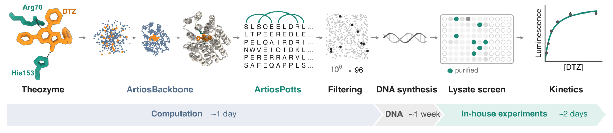
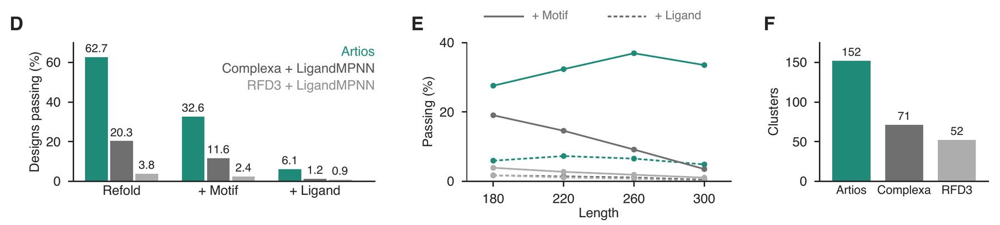
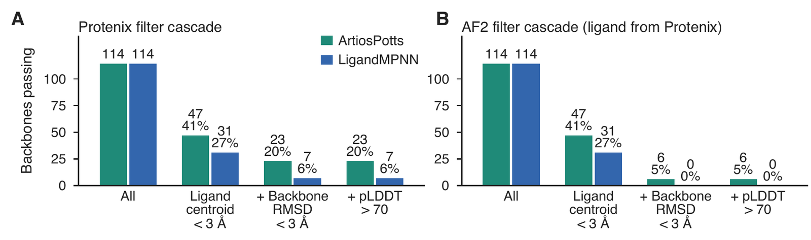

# Artios

Artios is a family of generative models from [Ligo Biosciences](https://ligo.bio) for designing ligand-binding proteins. Give it a catalytic or binding motif (a few residues plus one or more ligands) and it designs a protein around them. It is described in [*Artios: Designing Functional De Novo Enzymes with All-Atom Diffusion and Steerable Potts Models*](https://papers.ligo.bio/artios) (Cort, Egerton-Warburton, Goreci and Harris, 2026).



The design pipeline has two models:

| Model | Task | Input | Output |
|---|---|---|---|
| **[ArtiosBackbone](https://huggingface.co/Ligo-Biosciences/ArtiosBackbone)** | All-atom motif scaffolding (EDM diffusion) | Motif CIF + ligand definitions (JSON) | Backbone structures (NPZ / CIF) |
| **[ArtiosPotts](https://huggingface.co/Ligo-Biosciences/ArtiosPotts)** | Sequence design (Potts model on an MPNN encoder) | Backbone NPZ from ArtiosBackbone, or any PDB/mmCIF structure | Designed sequences (FASTA) and energies |

## Results

- **Motif scaffolding.** On the Atomic Motif Enzyme benchmark, with the added requirement that the co-folded ligand stays in the designed pocket, 6.1% of Artios designs pass, against 1.2% for Proteina-Complexa and 0.9% for RFdiffusion3 (both with LigandMPNN). Artios solves 34 of 38 active sites.
- **Sequence design.** On 114 held-out natural protein–ligand complexes, ArtiosPotts sequences refold and keep their ligands for 23 complexes, against 7 for LigandMPNN. Expressed in a cell-free system, they give a 1.6-fold higher median signal.
- **In the lab.** Artios produced active luciferases (7 of 85 designs tested) and cysteine esterases (17 of 88). The purified esterase ArCut1 has *k*<sub>cat</sub>/*K*<sub>M</sub> = 1.8 × 10<sup>3</sup> M<sup>−1</sup> s<sup>−1</sup>.





## Installation

Artios needs Python 3.11 or later. Install it from PyPI with [uv](https://docs.astral.sh/uv/) or pip:

```bash
uv tool install artios    # the `artios` command, in its own environment
uv pip install artios     # or into the active virtual environment (`pip install artios`)
```

On Python 3.14 and later, one dependency of biotite (`biotraj`) has no prebuilt wheel yet and is built from source, which needs a C compiler. Run `artios --version` to check the install.

To develop or train, install from source with uv and run the command as `uv run artios`:

```bash
git clone https://github.com/Ligo-Biosciences/artios.git
cd artios
uv sync                 # core dependencies (inference)
uv sync --all-extras    # everything, including training and data preparation
```

Optional extras install with `uv pip install "artios[train,data]"` or `uv sync --extra train`:

| Extra | Needed for |
|---|---|
| `train` | Training (`artios/runner/train_*.py`): wandb, pandera |
| `data` | Training-data preparation (`scripts/data/`) and pocket annotation |
| `electrostatics` | Electrostatics analysis (`artios/electrostatics`) |

### Chemical Component Dictionary (CCD)

Artios needs the wwPDB Chemical Component Dictionary and a matching pre-computed RDKit cache. On first use, it downloads a pinned snapshot from [Ligo-Biosciences/Artios-CCD](https://huggingface.co/datasets/Ligo-Biosciences/Artios-CCD) (about 550 MB), verifies the checksums and caches it for later (offline) runs.

To use local files instead, put both files in one directory and point `ARTIOS_CCD_DIR` at it, or, in a source checkout, place them in `ccd_files/` at the repository root:

```
ccd_files/
├── components.cif
└── components.cif.rdkit_mol.pkl
```

Both files must come from the same snapshot. `scripts/data/gen_ccd_cache.py` builds the RDKit cache from `components.cif`.

## Usage

Model weights and CCD files are downloaded from [Hugging Face](https://huggingface.co/Ligo-Biosciences) on first use (about 1.1 GB in total) and cached for later runs. A CUDA GPU is used automatically when available. CPUs work too, and the timings below are for a laptop CPU. Apple MPS is not supported.

Everything runs through the `artios` command (`artios --help`):

| Command | Does |
|---|---|
| `artios scaffold` | Generate backbones around a motif (ArtiosBackbone) |
| `artios design` | Design sequences for backbones or any PDB/mmCIF structure (ArtiosPotts) |
| `artios score` | Score sequences on a structure: Potts energy and pseudo-log-likelihood |
| `artios params` | Export the Potts fields h, couplings J and neighbour graph of a structure |

Pass `--checkpoint` to use your own weights instead of the released ones, and `-v` for detailed logs. Working with a coding agent? [AGENTS.md](https://github.com/Ligo-Biosciences/artios/blob/main/AGENTS.md) is a short guide to the command for agents.

### Backbone generation

`examples/backbone/` in this repository scaffolds the catalytic motif of orotidine 5′-monophosphate decarboxylase (six residues from PDB [1DBT](https://www.rcsb.org/structure/1DBT)) around its UMP ligand into a 128-residue design. Without a clone, download it first:

```bash
url=https://raw.githubusercontent.com/Ligo-Biosciences/artios/main/examples/backbone
curl -fsSL --create-dirs -o examples/backbone/input.json $url/input.json \
  -o examples/backbone/odcase_motif.cif $url/odcase_motif.cif

artios scaffold examples/backbone/input.json -n 5 -o output/backbone
```

This samples five backbones into `output/backbone/odcase_backbone.npz` (about 1.5 minutes). `--format cif` writes one CIF file per sample instead. The design chain (`0`) is poly-glycine; motif residues and ligands keep their own chains.

### Sequence design

Design four sequences for each generated backbone:

```bash
artios design output/backbone/odcase_backbone.npz -n 4 -o output/designs
```

This takes about 3 minutes per backbone and writes `output/designs/designs.fasta` with the designed chain of each sequence, and `output/designs/designs.jsonl` with every chain, the Potts energy (lower is better) and per-residue energies. Motif residues and ligands are context and keep their identities. `examples/sequence_design/backbone.npz` holds ten more backbones, 160 residues each, generated around the luciferase motif from the paper (an arginine and a histidine placed around diphenylterazine).

`artios design` also takes PDB and mmCIF files (or directories of them), so it works on any protein or complex. Residues are addressed by author chain and number, as in PyMOL:

```bash
# Redesign chain B of a complex, keeping residues 10-14 and 42 of chain B
artios design complex.pdb --design-chains B --fixed "B10-14 B42" -n 8 -o output/binder

# Redesign only a loop
artios design protein.cif --redesign "A30-41" -o output/loop

# Score designs (or, without a FASTA, the structure's own sequence)
artios score complex.pdb output/binder/designs.fasta -o output/scores
```

Selections are `A` (whole chain), `A42`, `A52B` (insertion code), `A10-20` (inclusive), or `1:42` for chain IDs that are not letters. Sampling options: `--temperature`, `--allow-cys`, `--allow-met` (both excluded by default), and `--set KEY=VALUE` for any `artios_mpnn.potts.sampling` option, e.g. `--set cfg_scale=2.0` or `--set energy_bias.W=-0.5`. Rerunning into the same output directory skips finished targets.

The same functionality is available from Python:

```python
from artios.potts import PottsDesigner, load_target, parse_selection

designer = PottsDesigner()
target = load_target("complex.pdb")
designs = designer.design(target, design_chains=["B"], fixed=parse_selection("B10-14"), num_sequences=8)
scores = designer.score(target, [d.sequences for d in designs])
params, _ = designer.potts_params(target)  # h, J and neighbour graph as tensors
```

### Input format

Backbone generation takes a JSON file describing the design length and the motif:

```json
{
  "name": "cutinase",
  "task": "backbone",
  "spec": {
    "design": [{"length": 200}],
    "motif": {
      "cif_file": "evaluation/inputs/motifs/cutinase/cutinase_motif.cif",
      "ligands": [
        {
          "cif_res_name": "UNK",
          "chain_id": "1",
          "full_ligand": {
            "type": "smiles",
            "smiles": "CCCCCCC[C:1](=[O:2])[O:3]C1=CC2=C([C:4]=C1)C(=[C:5]C(=O)O2)C",
            "atom_map": {"C1": 1, "O1": 2, "O": 3, "C2": 4, "C3": 5}
          }
        }
      ]
    }
  }
}
```

Ligands can be given as CCD codes (`{"type": "ccd", "codes": ["ZN"]}`) or as atom-mapped SMILES, as above. See:

- [Motif input format](https://github.com/Ligo-Biosciences/artios/blob/main/docs/motif_input_format.md): motif CIF rules, CCD and SMILES ligands
- [Sequence design input format](https://github.com/Ligo-Biosciences/artios/blob/main/docs/sequence_design_input_format.md): JSON input of the older `python -m artios.runner.inference` entry point, still used by `evaluation/`
- [Motif stitching](https://github.com/Ligo-Biosciences/artios/blob/main/docs/motif_stitching.md): how motif residues flow from backbone generation to the final design

`evaluation/inputs/` holds the motifs (`motifs/`) and backbone inputs (`artios/`) behind the paper: the AME benchmark and the luciferase, esterase and cutinase campaigns. Their design `length` is left empty for the benchmark runner to fill; set it before running one with `artios scaffold`.

## Training

Training code is included as a reference: `artios/runner/train_backbone.py` and `artios/runner/train_potts.py`, launched through `scripts/training/`. See [preparing training data](https://github.com/Ligo-Biosciences/artios/blob/main/docs/prepare_training_data.md) and [data sampling weights](https://github.com/Ligo-Biosciences/artios/blob/main/docs/data_sampling_weights.md).

The training data, a 278 GB SquashFS snapshot with the train and evaluation split indices, is in [Artios-Training-Data](https://huggingface.co/datasets/Ligo-Biosciences/Artios-Training-Data). Fragment-level structural clusters of its MGnify and AlphaFold DB structures are in [Artios-Clusters](https://huggingface.co/datasets/Ligo-Biosciences/Artios-Clusters).

## Repository layout

```
artios/
├── model/   model architectures (ArtiosBackbone, ArtiosPotts, ...)
├── data/    input parsing, featurization and data pipeline
├── configs/ default configuration for training and inference
├── runner/  inference and training entry points
└── ...      metrics, contacts, electrostatics, utilities
scripts/     data preparation and training launch scripts
docs/        input formats and method notes
tests/       test suite (run with `uv run pytest -m "not slow"`)
```

## License

Artios is released under the [Apache License 2.0](https://github.com/Ligo-Biosciences/artios/blob/main/LICENSE). It is a derivative of Protenix and includes code adapted from other open-source projects; see [NOTICE](https://github.com/Ligo-Biosciences/artios/blob/main/NOTICE) for attributions.

## Citation

```bibtex
@misc{artios2026,
  title  = {Artios: Designing Functional De Novo Enzymes with All-Atom Diffusion and Steerable Potts Models},
  author = {Cort, Oliver and Egerton-Warburton, Emily and Goreci, Arda and Harris, Edward},
  year   = {2026},
  note   = {Ligo Biosciences},
  url    = {https://papers.ligo.bio/artios}
}
```
